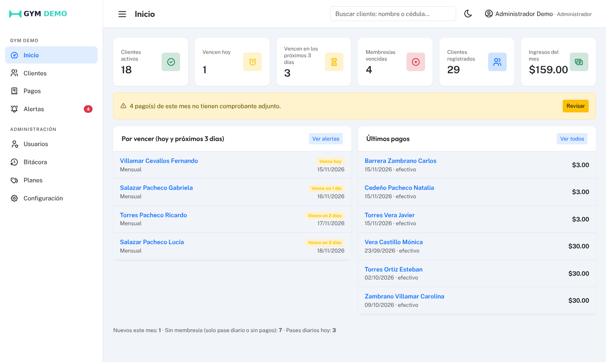
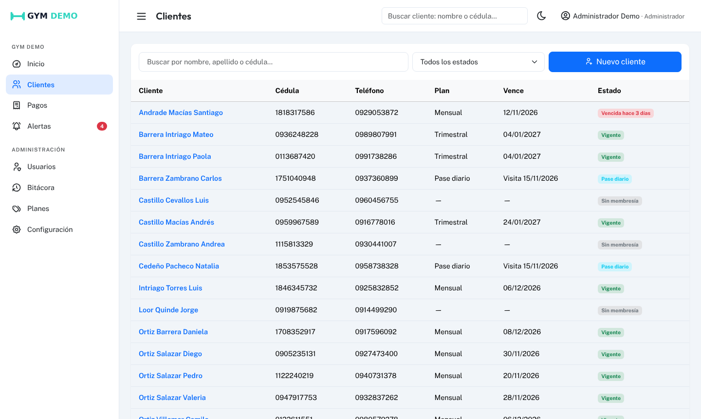
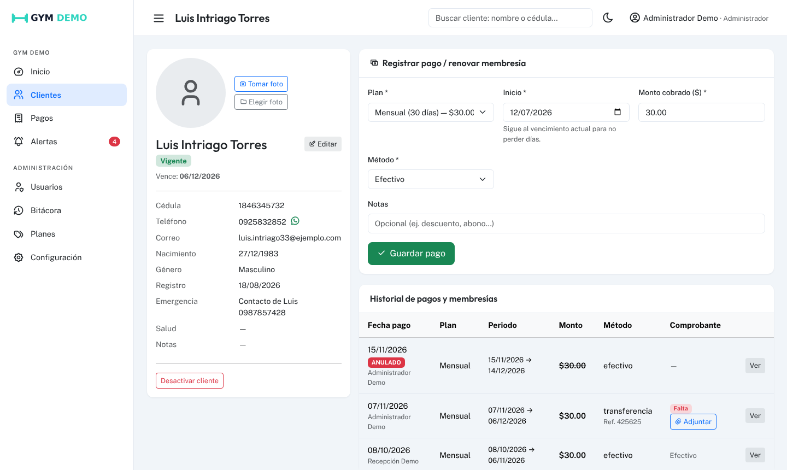
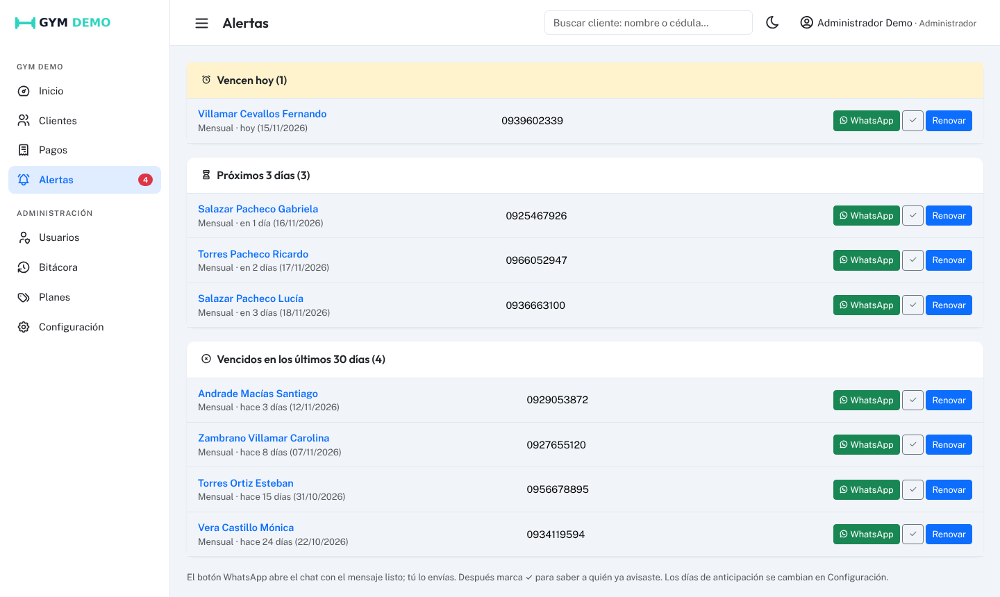
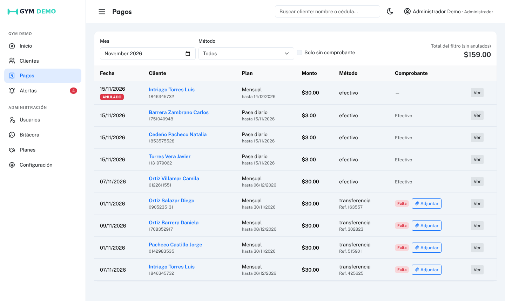
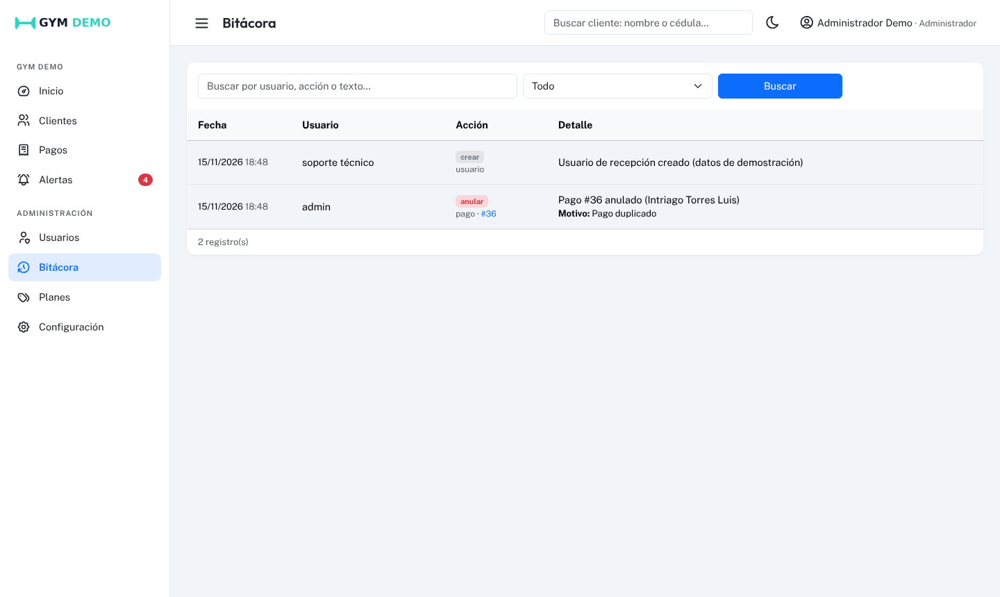
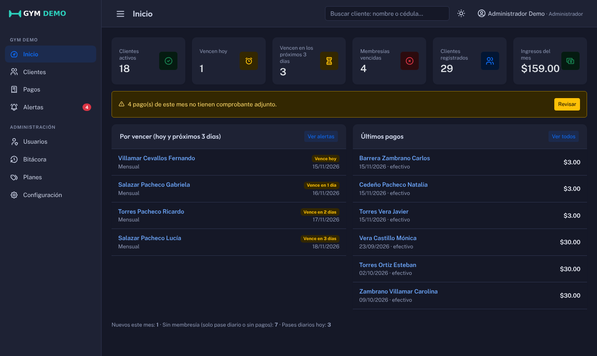
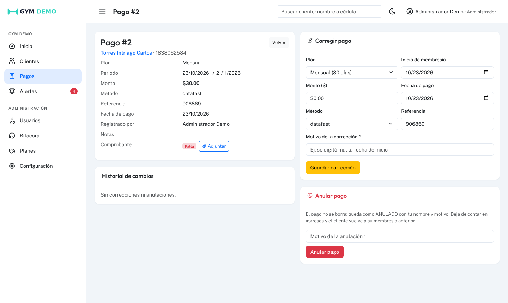
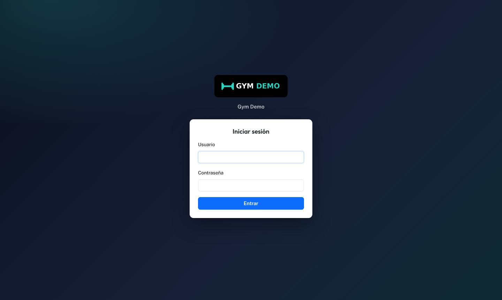

# Gym Manager

Sistema web para administrar **clientes, membresías y pagos** de un gimnasio. Funciona de forma **local** (una laptop en recepción) con una base de datos SQLite, sin depender de internet ni de servicios en la nube.

> Proyecto de demostración. Todos los datos de ejemplo son ficticios.



## Funciones

- **Clientes**: registro con datos personales, contacto de emergencia, condiciones médicas y foto (cámara del celular o webcam). Búsqueda rápida por nombre, apellido o cédula.
- **Membresías y planes**: planes configurables (mensual, trimestral, pase diario…). El vencimiento se calcula solo y, si el cliente renueva antes de vencer, no pierde los días restantes.
- **Pagos con comprobante**: efectivo, transferencia o Datafast. Los pagos no efectivo exigen adjuntar la foto del comprobante, tomada desde el celular por la red local.
- **Alertas de vencimiento**: quién vence hoy, en los próximos 3 días o ya venció, con enlace a WhatsApp con el mensaje prellenado.
- **Roles y permisos** validados en el servidor:
  - *Administrador*: todo, incluyendo ingresos, planes, configuración, usuarios y bitácora.
  - *Recepción*: registra clientes y pagos; no ve ingresos totales ni puede anular o corregir pagos.
- **Anular en lugar de borrar**: un pago anulado queda en el historial con quién, cuándo y por qué, y deja de contar en ingresos y membresía.
- **Bitácora de auditoría** con el valor anterior y el nuevo de cada corrección.
- **Respaldos automáticos** de la base cada 6 horas y copia de seguridad antes de cada migración.
- Tema claro / oscuro.

## Tecnologías

| Capa | Tecnología |
|---|---|
| Servidor | Node.js 22.16+, Express 4 |
| Vistas | EJS + express-ejs-layouts |
| Base de datos | SQLite (`node:sqlite`, incluido en Node) con migraciones propias |
| Autenticación | express-session, bcryptjs |
| Archivos | multer (validación del tipo real del archivo) |
| Interfaz | Bootstrap 5.3, Tabler Icons, CSS propio (tema claro/oscuro) y JavaScript sin frameworks |
| Seguridad | CSRF, límite de intentos de login, cabeceras de seguridad, archivos fuera de la carpeta pública |

## Instalación

Requiere [Node.js](https://nodejs.org) 22.16 o superior.

```bash
npm install
npm run crear-admin     # crea el administrador (usuario y clave a tu elección)
npm start               # http://localhost:3000
```

### Probar con datos ficticios

```bash
npm install
npm run demo            # crea 29 clientes inventados y dos usuarios de prueba
npm start
```

Usuarios de la demo (clave `Demo12345`): `admin` (administrador) y `recepcion` (recepción).

### Comandos útiles

| Comando | Qué hace |
|---|---|
| `npm start` | Inicia el sistema |
| `npm run dev` | Inicia con recarga automática |
| `npm run crear-admin` | Crea un administrador (solo desde la máquina del servidor) |
| `npm run reset-clave` | Restablece la clave de un usuario |
| `npm run demo` | Carga datos ficticios (base vacía) |

En Windows también hay `iniciar.bat`, `Gym Manager.vbs` (arranque sin ventana negra) y `detener.bat`.

### Usarlo desde el celular

Con el celular en la misma red WiFi, abre `http://IP-DE-LA-LAPTOP:3000` (la IP se ve con `ipconfig`). Sirve para fotografiar comprobantes y fotos de clientes.

## Capturas

| Clientes | Ficha del cliente |
|---|---|
|  |  |

| Alertas | Pagos |
|---|---|
|  |  |

| Bitácora | Tema oscuro |
|---|---|
|  |  |

| Detalle de pago (anular / corregir) | Acceso |
|---|---|
|  |  |

## Estructura

```
app.js            Servidor, sesión, CSRF y rutas
lib/              Base de datos y migraciones, utilidades, permisos, auditoría, respaldos
routes/           Clientes, pagos, alertas, usuarios, administración
views/            Plantillas EJS
public/           Estilos, scripts e imágenes
scripts/          Comandos de soporte (crear admin, reset de clave, datos demo)
data/             (no se sube a Git) base de datos, fotos, comprobantes, respaldos
```

## Licencias y créditos

El código del proyecto es propio. Las bibliotecas de terceros que se incluyen en `public/vendor` son de código abierto (licencia MIT): [Bootstrap](https://getbootstrap.com) y [Tabler Icons](https://tabler.io/icons). Las tipografías Public Sans y Outfit usan la licencia SIL Open Font License. No se incluye ninguna plantilla comercial.
